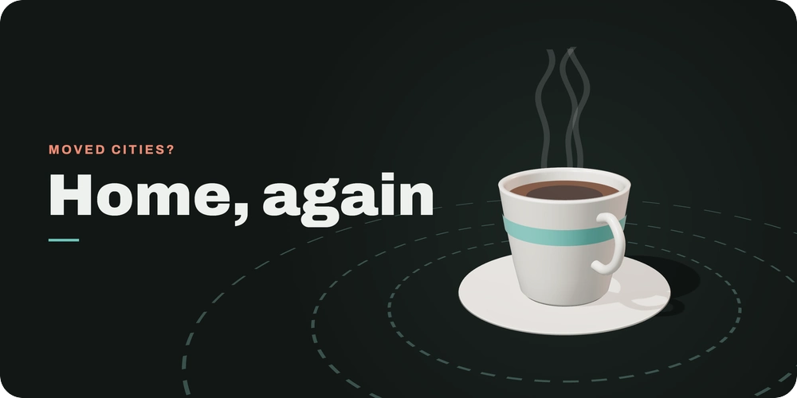
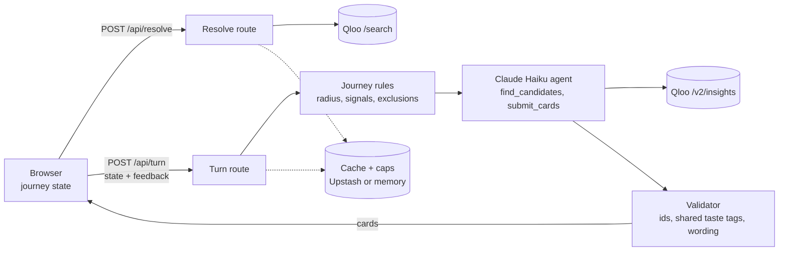

<p align="center">
<picture>
  <source media="(prefers-reduced-motion: reduce)" srcset="docs/cover-poster.png">
  
</picture>
</p>

<h1 align="center">Home, again</h1>
<p align="center"><strong>You moved. Find the café near your new place that feels like your old regular.</strong></p>
<p align="center">
  <a href="https://home-again-gamma.vercel.app">Live demo</a> ·
  <a href="#-how-it-works">How it works</a> ·
  <a href="#-why-qloo">Why Qloo</a> ·
  <a href="#-run-it-locally">Run it locally</a> ·
  <a href="#%EF%B8%8F-license">License</a>
</p>
<p align="center">
  <a href="LICENSE"></a>
  
  
  
</p>

Built for the Qloo Agentic Hackathon 2026.

## ☕ How it works

1. Name the café you used to go to, or press the example (Fritz Coffee Company Dohwa, Seoul → East Village, New York).
2. Each week you get up to three cafés. A card shows the walking distance, the taste signals the café shares with your old one on Qloo, and what is still unverified, such as hours or seating.
3. Tell it how each one went:

| You press | What changes next week |
| --- | --- |
| ♥ Loved it | The café joins the taste signal and counts as a visit |
| Too crowded | The café sits out one week; the taste signal stays |
| Not for me | The café is gone for good |

4. The search circle tightens every week: 1000 m, then 700 m, then 500 m. If a round comes up empty, the app offers to look 1500 m out.
5. Love the same café twice and it becomes **your new regular**. Three weeks is the whole journey.

## 🧭 Why Qloo

Qloo supplies every candidate, its ranking and its evidence. The model only chooses among Qloo's candidates and writes one line about the choice, and code checks that line before you see it:

- The card's café must be one Qloo returned for this round.
- Every "shares taste signals with" tag must be a taste tag both cafés carry on Qloo: ambience, decor, drinks, menu. Crowd, age and payment tags never reach a card. If Qloo has no taste tags for your old café, the card may cite the candidate's own taste tags instead.
- Lines about "people who…" or "fans of…" are rejected.

If the model's answer fails the check twice, the app shows Qloo's top three by affinity instead. Take Qloo away and there is nothing left to show.

## 🏗️ Architecture



The server keeps no journey state. The browser holds it and sends it with every request, and the server validates it with zod each time. Qloo and Anthropic keys stay on the server. Qloo answers are cached for 24 hours, and calls are capped per session and per day.

<details>
<summary>What the agent does in one round</summary>

1. `find_candidates` asks Qloo `/v2/insights` for cafés inside this week's circle, with your old café and every café you loved as the taste signal and every excluded café filtered out.
2. `submit_cards` returns up to three picks, each with its taste tags, what is unverified and one sentence of reasoning.
3. The validator checks the picks. A failed answer gets one retry with the reason; a second failure falls back to Qloo's ranking.

Name, address and distance on a card always come from Qloo's data, never from the model.

</details>

## 🚀 Run it locally

You need Node.js and pnpm.

```bash
pnpm install
cp .env.example .env.local   # then fill in QLOO_API_KEY and ANTHROPIC_API_KEY
pnpm dev
```

Open http://localhost:3000 and press the example button.

<details>
<summary>Environment variables</summary>

| Variable | Required | Default |
| --- | --- | --- |
| `QLOO_API_KEY` | yes | |
| `QLOO_BASE_URL` | no | `https://hackathon.api.qloo.com` |
| `ANTHROPIC_API_KEY` | no; without it cards come from Qloo's ranking | |
| `UPSTASH_REDIS_REST_URL`, `UPSTASH_REDIS_REST_TOKEN` | no; without them the cache and caps live in memory | |
| `QLOO_SESSION_CAP`, `QLOO_DAILY_CAP` | no | 8, 300 |
| `LLM_SESSION_ROUNDS` | no | 6 |

Checks: `pnpm test`, `pnpm typecheck`, `pnpm build`.

</details>

## 🧱 Limits

- The neighbourhood presets are East Village, Williamsburg and West Village in New York. Qloo's café coverage is thinner outside large US cities.
- Each card marks opening hours, seating and how busy the café is right now as unverified.
- Without Upstash, the per-session and daily caps are counted separately on each server instance.
- A session is an anonymous cookie, so clearing cookies starts a fresh session budget. The daily cap is the hard limit.

Notes on the Qloo request and response shape are in [docs/qloo-contract.md](docs/qloo-contract.md).

## ⚖️ License

MIT. See [LICENSE](LICENSE).

---

<p align="center">
  <a href="https://home-again-gamma.vercel.app">Live demo</a> ·
  <a href="#-how-it-works">How it works</a> ·
  <a href="#-run-it-locally">Run it locally</a> ·
  <a href="docs/qloo-contract.md">Qloo contract</a> ·
  <a href="LICENSE">License</a>
</p>
